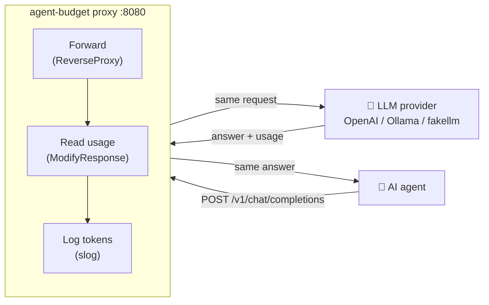
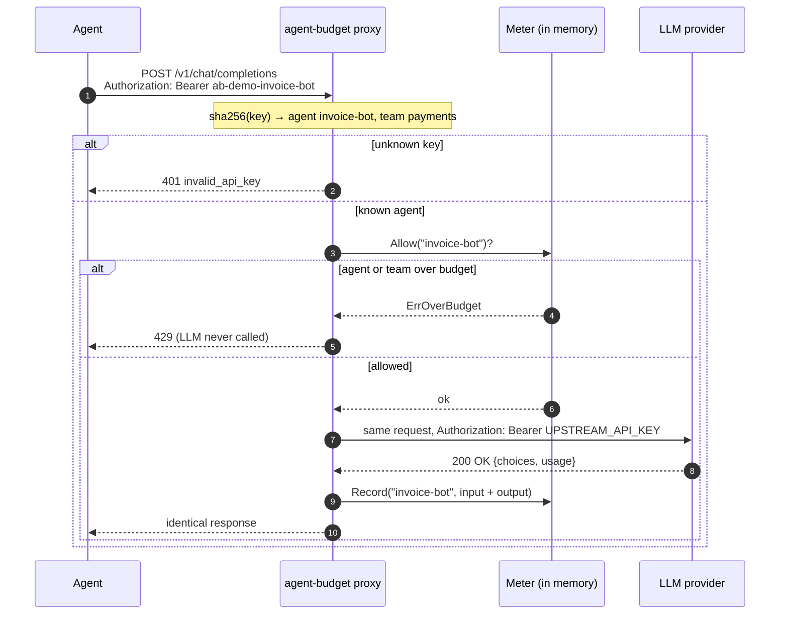

<div align="center">

# agent-budget

**Token budgets for AI agents — see who spent what, and stop them before they overspend.**

[](https://github.com/chikolavosaki-sys/agent-budget/actions/workflows/ci.yml)


[](LICENSE)

[Quick start](#-quick-start) · [How it works](#-how-it-works) · [Docs](#-documentation) · [Roadmap](#-roadmap)

</div>

---

## 💡 The problem

AI agents call large language models (LLMs) in loops. Every call costs **tokens**, and tokens cost money.
One buggy agent stuck in a loop can burn a whole month's budget overnight — and usually nobody knows *which* agent did it until the bill arrives.

**agent-budget** is a small proxy that sits between your agents and the LLM provider. Every agent gets its own **virtual key**. The proxy knows from the key *which agent* is calling, who **owns** it and which **team** pays, counts the tokens of every request, and blocks the agent with HTTP `429` once its own budget — or its team's — is used up.

> Think of it like the **canteen counter**: you don't walk into the kitchen; you order at the counter. The counter person passes your order on, brings the food back, and writes in a register who ate what. agent-budget is that counter for LLM calls.

## ✨ What works today (M0 – M2)

- ✅ Forwards any **OpenAI-compatible** request (`/v1/chat/completions`) to a provider — OpenAI, Ollama, or anything that speaks the same API
- ✅ Reads `usage.prompt_tokens` / `usage.completion_tokens` from each response and logs them
- ✅ The agent gets the **exact same bytes** back — the proxy is invisible
- ✅ Never logs prompts, answers, virtual keys or API keys (tests check this)
- ✅ **Streaming** (`"stream": true`): words reach the agent live, and the tokens are still counted
- ✅ Handles gzip, upstream errors (502), and graceful shutdown
- ✅ **Virtual keys per agent**: the agent sends `Authorization: Bearer ab-…`; unknown key → `401`. The agents file stores only a **hash** of each key
- ✅ **The real provider key stays in the proxy**: it swaps the virtual key for `UPSTREAM_API_KEY` before forwarding
- ✅ **Budgets per agent and per team**: an agent is blocked (`429`) when its own budget *or* its team's shared budget is used up
- ✅ **Every agent has an owner** — the proxy refuses to start otherwise
- ✅ **Live usage** per team and per agent at `GET /budgets`
- ✅ Thread-safe counters (mutex), proven with Go's race detector and a concurrency test
- ✅ Ships with **`fakellm`**, a fake LLM server, so you can demo everything with no API key and no GPU

```text
level=WARN msg="request rejected: missing or unknown virtual key" path=/v1/chat/completions
level=INFO msg="llm request" status=200 agent=invoice-bot team=payments model=demo input_tokens=11 output_tokens=11
level=WARN msg="request blocked" agent=invoice-bot team=payments status=429 reason="agent \"invoice-bot\" used 66 of 50 tokens: over token budget"
level=WARN msg="request blocked" agent=refund-bot team=payments status=429 reason="team \"payments\" used 110 of 100 tokens: over token budget"
```

## 🚀 Quick start

**Needs:** Go 1.26 or newer, `make`, `curl`.

```bash
git clone https://github.com/chikolavosaki-sys/agent-budget.git
cd agent-budget
make build
```

Open **two terminals**:

```bash
# Terminal 1 — a fake LLM on :9090
make run-fake

# Terminal 2 — the proxy on :8080 with the demo agents from examples/agents.json
make run-proxy
```

The demo has two teams and three agents:

| Agent | Team (budget) | Own budget | Demo key |
|---|---|---|---|
| `invoice-bot` | payments (100) | 50 | `ab-demo-invoice-bot` |
| `refund-bot` | payments (100) | — | `ab-demo-refund-bot` |
| `search-bot` | search (1000) | — | `ab-demo-search-bot` |

> The demo keys are deliberately simple so the commands below work. Make real keys with `make keygen`.

Act like **invoice-bot** and send a request **to the proxy** — run it 4 times:

```bash
curl -s localhost:8080/v1/chat/completions \
  -H 'Authorization: Bearer ab-demo-invoice-bot' \
  -d '{"model":"demo","messages":[{"role":"user","content":"Explain Kubernetes in one line please, simply."}]}'
```

The first three get an answer. The fourth is blocked by the agent's own budget: 🎉

```json
{"error":{"code":"budget_exceeded","message":"agent \"invoice-bot\" used 66 of 50 tokens: over token budget","type":"budget_exceeded"}}
```

Now try `ab-demo-refund-bot`: it has no budget of its own, but after two calls the **team** `payments` is used up, so it is blocked too. `search-bot` keeps working — it is in another team. A wrong key gets `401`.

See everyone's spend:

```bash
curl -s localhost:8080/budgets
```

Want a real model instead? Install [Ollama](https://ollama.com) (free, runs locally), then:

```bash
ollama pull llama3.2
AGENTS_FILE=examples/agents.json UPSTREAM_URL=http://localhost:11434 ./bin/proxy
```

More options: [docs/GETTING_STARTED.md](docs/GETTING_STARTED.md).

## 🔍 How it works



The life of one request:



The full walkthrough — network → process → memory — is in [docs/ARCHITECTURE.md](docs/ARCHITECTURE.md).

## ⚙️ Configuration

| Variable | Default | Meaning |
|---|---|---|
| `LISTEN_ADDR` | `:8080` | Where the proxy listens |
| `UPSTREAM_URL` | `http://localhost:11434` | Base URL of the LLM provider (default is Ollama) |
| `AGENTS_FILE` | *(empty)* | JSON file with teams, agents, owners, budgets and key hashes ([example](examples/agents.json)). Empty = watch-only: no keys checked, nothing blocked |
| `UPSTREAM_API_KEY` | *(empty)* | The real provider key, sent instead of the agent's virtual key. Empty = no `Authorization` sent (fine for Ollama) |
| `LOG_FORMAT` | `text` | `text` for humans, `json` for log tools |

| Endpoint | What it does |
|---|---|
| `GET /healthz` | `ok` — is the proxy alive? |
| `GET /budgets` | Live usage per team and per agent as JSON |
| anything else | Forwarded to the LLM provider (after the key and budget checks) |

| Command | What it does |
|---|---|
| `proxy keygen` (or `make keygen`) | Prints a new random virtual key and the `key_sha256` to put in the agents file |

## 🗂️ Project structure

```text
agent-budget/
├── cmd/
│   ├── proxy/        # the proxy program (main.go)
│   └── fakellm/      # fake OpenAI-compatible LLM for demos
├── examples/
│   └── agents.json   # demo teams, agents and key hashes
├── internal/
│   ├── proxy/
│   │   ├── proxy.go        # key check, budget gate, forward, read usage
│   │   ├── usage.go        # parse "usage" from the response JSON
│   │   ├── stream.go       # include_usage for streams + reader that counts SSE
│   │   └── *_test.go       # tests with a fake provider (incl. concurrency)
│   ├── agents/
│   │   ├── agents.go       # load + validate agents file, virtual key → agent
│   │   └── agents_test.go
│   └── meter/
│       ├── meter.go        # per-agent + per-team counters behind a mutex
│       └── meter_test.go   # table tests + race-detector concurrency test
├── docs/             # architecture, getting started, concepts, decisions
├── Makefile          # build / test / lint / run
└── ROADMAP.md
```

## 🧪 Development

```bash
make help       # list all commands
make build      # build bin/proxy and bin/fakellm
make test       # unit tests with the Go race detector
make cover      # test coverage report
make lint       # golangci-lint
```

Tests use `httptest` to start a **fake provider** inside the test, so they need no network and no API key.

## 🗺️ Roadmap

| | Milestone | What it adds |
|---|---|---|
| ✅ | **M0 — Hello proxy** | Forward requests, log token usage |
| ✅ | **M1 — Count and block** | Per-team counter in memory; HTTP `429` when over budget |
| ✅ | **M2 — Know the agent** | Virtual key per agent; owner + per-agent and per-team budgets |
| ⬜ | **M3 — Budgets in Kubernetes** | A `TokenBudget` custom resource; change YAML → change the live limit |
| ⬜ | **M4 — See it** | OpenTelemetry traces + Prometheus metrics + a Grafana dashboard |
| ⬜ | **M5 — Survive restarts** | Durable counters (Redis/Postgres), multiple proxy replicas |
| ⬜ | **M6 — kagent** | Real Kubernetes AI agents running through the proxy |

Details: [ROADMAP.md](ROADMAP.md).

## ⚠️ Known limits

- A stream that **breaks before its last chunk** is not counted (the usage arrives only at the end).
- **Soft limit:** the check happens *before* a request and tokens are added *after*, so a budget can go a little over (in the demo: 66 of 50). See [Architecture → soft limit](docs/ARCHITECTURE.md#why-the-limit-is-soft).
- Counters live **in memory**: restarting the proxy resets them (durable counters are M5).
- Changing the agents file needs a **proxy restart** (live reload comes with the Kubernetes CRD in M3).
- `GET /budgets` has **no login** — anyone who can reach the proxy can see names and spend (no keys or prompts).
- Only the **OpenAI-compatible** response format is understood.

## 📚 Documentation

- [Getting started](docs/GETTING_STARTED.md) — run it with fakellm, Ollama or OpenAI
- [Architecture](docs/ARCHITECTURE.md) — how a request flows, layer by layer
- [Concepts](docs/CONCEPTS.md) — every term explained with an everyday analogy
- [Decisions](docs/DECISIONS.md) — why things are built the way they are

## 📄 License

[Apache-2.0](LICENSE). Built as a college project to learn Go, Kubernetes and distributed systems.
