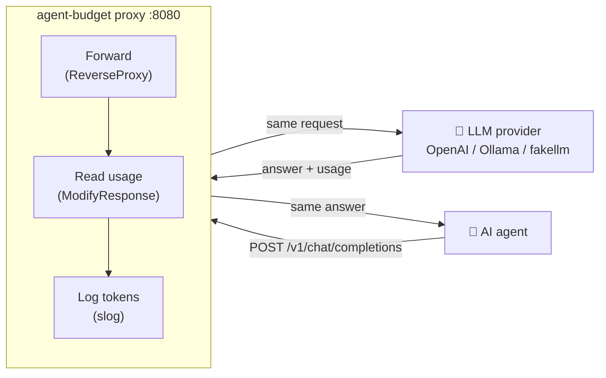
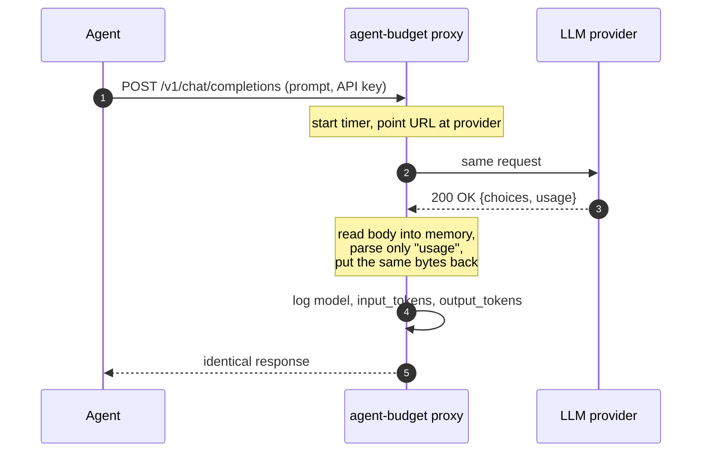

<div align="center">

# agent-budget

**Token budgets for AI agents — see who spent what, and (soon) stop them before they overspend.**

[](https://github.com/chikolavosaki-sys/agent-budget/actions/workflows/ci.yml)


[](LICENSE)

[Quick start](#-quick-start) · [How it works](#-how-it-works) · [Docs](#-documentation) · [Roadmap](#-roadmap)

</div>

---

## 💡 The problem

AI agents call large language models (LLMs) in loops. Every call costs **tokens**, and tokens cost money.
One buggy agent stuck in a loop can burn a whole month's budget overnight — and usually nobody knows *which* agent did it until the bill arrives.

**agent-budget** is a small proxy that sits between your agents and the LLM provider. It sees every request, counts the tokens, and — in later milestones — blocks an agent the moment it goes over its budget.

> Think of it like the **canteen counter**: you don't walk into the kitchen; you order at the counter. The counter person passes your order on, brings the food back, and writes in a register who ate what. agent-budget is that counter for LLM calls.

## ✨ What works today (M0)

- ✅ Forwards any **OpenAI-compatible** request (`/v1/chat/completions`) to a provider — OpenAI, Ollama, or anything that speaks the same API
- ✅ Reads `usage.prompt_tokens` / `usage.completion_tokens` from each response and logs them
- ✅ The agent gets the **exact same bytes** back — the proxy is invisible
- ✅ Never logs prompts, answers or API keys (there is a test that checks this)
- ✅ Handles gzip, upstream errors (502), streaming pass-through, and graceful shutdown
- ✅ Ships with **`fakellm`**, a fake LLM server, so you can demo everything with no API key and no GPU

```text
level=INFO msg="llm request" method=POST path=/v1/chat/completions status=200 duration_ms=2 model=demo-model input_tokens=11 output_tokens=11
```

## 🚀 Quick start

**Needs:** Go 1.26 or newer, `make`, `curl`.

```bash
git clone https://github.com/chikolavosaki-sys/agent-budget.git
cd agent-budget
make build
```

Open **two terminals**:

```bash
# Terminal 1 — a fake LLM on :9090
make run-fake

# Terminal 2 — the proxy on :8080, in front of the fake LLM
make run-proxy
```

Now act like an agent and send a request **to the proxy**:

```bash
curl -s localhost:8080/v1/chat/completions \
  -H 'Content-Type: application/json' \
  -d '{"model":"demo-model","messages":[{"role":"user","content":"Explain Kubernetes in one line"}]}'
```

You get the LLM's answer back, and Terminal 2 prints how many tokens it used. 🎉

Want a real model instead? Install [Ollama](https://ollama.com) (free, runs locally), then:

```bash
ollama pull llama3.2
UPSTREAM_URL=http://localhost:11434 ./bin/proxy
```

More options: [docs/GETTING_STARTED.md](docs/GETTING_STARTED.md).

## 🔍 How it works



The life of one request:



The full walkthrough — network → process → memory — is in [docs/ARCHITECTURE.md](docs/ARCHITECTURE.md).

## ⚙️ Configuration

| Variable | Default | Meaning |
|---|---|---|
| `LISTEN_ADDR` | `:8080` | Where the proxy listens |
| `UPSTREAM_URL` | `http://localhost:11434` | Base URL of the LLM provider (default is Ollama) |
| `LOG_FORMAT` | `text` | `text` for humans, `json` for log tools |

Health check: `GET /healthz` → `ok`.

## 🗂️ Project structure

```text
agent-budget/
├── cmd/
│   ├── proxy/        # the proxy program (main.go)
│   └── fakellm/      # fake OpenAI-compatible LLM for demos
├── internal/
│   └── proxy/
│       ├── proxy.go        # forward request, read usage, log it
│       ├── usage.go        # parse "usage" from the response JSON
│       └── *_test.go       # unit tests with a fake provider
├── docs/             # architecture, getting started, concepts, decisions
├── Makefile          # build / test / lint / run
└── ROADMAP.md
```

## 🧪 Development

```bash
make help       # list all commands
make build      # build bin/proxy and bin/fakellm
make test       # unit tests with the Go race detector
make cover      # test coverage report
make lint       # golangci-lint
```

Tests use `httptest` to start a **fake provider** inside the test, so they need no network and no API key.

## 🗺️ Roadmap

| | Milestone | What it adds |
|---|---|---|
| ✅ | **M0 — Hello proxy** | Forward requests, log token usage |
| ⬜ | **M1 — Count and block** | Per-team counter in memory; HTTP `429` when over budget |
| ⬜ | **M2 — Know the agent** | Identify which agent and team sent each request |
| ⬜ | **M3 — Budgets in Kubernetes** | A `TokenBudget` custom resource; change YAML → change the live limit |
| ⬜ | **M4 — See it** | OpenTelemetry traces + Prometheus metrics + a Grafana dashboard |
| ⬜ | **M5 — Survive restarts** | Durable counters (Redis/Postgres), multiple proxy replicas |
| ⬜ | **M6 — kagent** | Real Kubernetes AI agents running through the proxy |

Details: [ROADMAP.md](ROADMAP.md).

## ⚠️ Known limits (M0)

- **Streaming** answers (`"stream": true`) are passed through but **not counted** yet.
- Only the **OpenAI-compatible** response format is understood.
- Nothing is enforced yet — M0 only *watches*. Blocking comes in M1.

## 📚 Documentation

- [Getting started](docs/GETTING_STARTED.md) — run it with fakellm, Ollama or OpenAI
- [Architecture](docs/ARCHITECTURE.md) — how a request flows, layer by layer
- [Concepts](docs/CONCEPTS.md) — every term explained with an everyday analogy
- [Decisions](docs/DECISIONS.md) — why things are built the way they are

## 📄 License

[Apache-2.0](LICENSE). Built as a college project to learn Go, Kubernetes and distributed systems.
