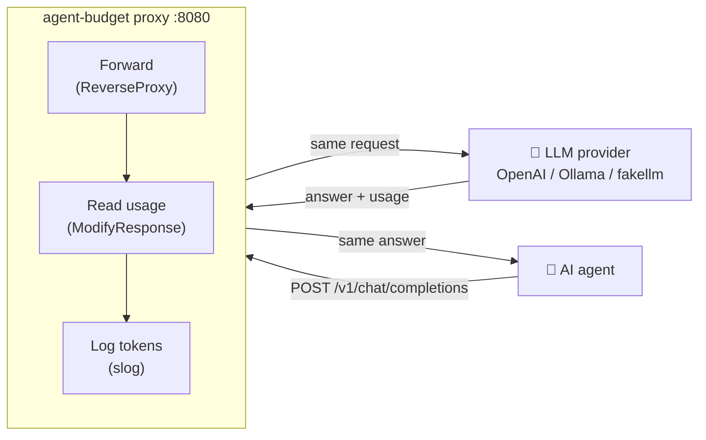
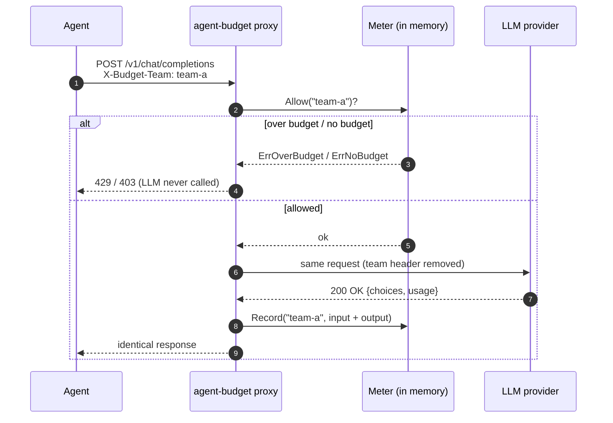

<div align="center">

# agent-budget

**Token budgets for AI agents — see who spent what, and stop them before they overspend.**

[](https://github.com/chikolavosaki-sys/agent-budget/actions/workflows/ci.yml)


[](LICENSE)

[Quick start](#-quick-start) · [How it works](#-how-it-works) · [Docs](#-documentation) · [Roadmap](#-roadmap)

</div>

---

## 💡 The problem

AI agents call large language models (LLMs) in loops. Every call costs **tokens**, and tokens cost money.
One buggy agent stuck in a loop can burn a whole month's budget overnight — and usually nobody knows *which* agent did it until the bill arrives.

**agent-budget** is a small proxy that sits between your agents and the LLM provider. It sees every request, counts the tokens per team, and blocks a team with HTTP `429` once it has used up its budget.

> Think of it like the **canteen counter**: you don't walk into the kitchen; you order at the counter. The counter person passes your order on, brings the food back, and writes in a register who ate what. agent-budget is that counter for LLM calls.

## ✨ What works today (M0 + M1)

- ✅ Forwards any **OpenAI-compatible** request (`/v1/chat/completions`) to a provider — OpenAI, Ollama, or anything that speaks the same API
- ✅ Reads `usage.prompt_tokens` / `usage.completion_tokens` from each response and logs them
- ✅ The agent gets the **exact same bytes** back — the proxy is invisible
- ✅ Never logs prompts, answers or API keys (there is a test that checks this)
- ✅ **Streaming** (`"stream": true`): words reach the agent live, and the tokens are still counted
- ✅ Handles gzip, upstream errors (502), and graceful shutdown
- ✅ **Per-team token budgets**: agents say their team in the `X-Budget-Team` header; over budget → `429`, no budget → `403` (fail closed)
- ✅ **Live usage** at `GET /budgets`
- ✅ Thread-safe counters (mutex), proven with Go's race detector and a concurrency test
- ✅ Ships with **`fakellm`**, a fake LLM server, so you can demo everything with no API key and no GPU

```text
level=INFO msg="llm request" status=200 team=team-a model=demo input_tokens=11 output_tokens=11
level=INFO msg="llm request" status=200 team=team-a model=demo input_tokens=11 output_tokens=11
level=INFO msg="llm request" status=200 team=team-a model=demo input_tokens=11 output_tokens=11
level=WARN msg="request blocked" team=team-a status=429 reason="team \"team-a\" used 66 of 50 tokens: team is over its token budget"
```

## 🚀 Quick start

**Needs:** Go 1.26 or newer, `make`, `curl`.

```bash
git clone https://github.com/chikolavosaki-sys/agent-budget.git
cd agent-budget
make build
```

Open **two terminals**:

```bash
# Terminal 1 — a fake LLM on :9090
make run-fake

# Terminal 2 — the proxy on :8080, with demo budgets: default=100, team-a=50
make run-proxy
```

Now act like an agent from **team-a** and send a request **to the proxy** — run it 4 times:

```bash
curl -s localhost:8080/v1/chat/completions \
  -H 'Content-Type: application/json' \
  -H 'X-Budget-Team: team-a' \
  -d '{"model":"demo-model","messages":[{"role":"user","content":"Explain Kubernetes in one line please, simply."}]}'
```

The first three get an answer. The fourth gets blocked: 🎉

```json
{"error":{"code":"budget_exceeded","message":"team \"team-a\" used 66 of 50 tokens: team is over its token budget","type":"budget_exceeded"}}
```

See everyone's spend:

```bash
curl -s localhost:8080/budgets
```

Want a real model instead? Install [Ollama](https://ollama.com) (free, runs locally), then:

```bash
ollama pull llama3.2
UPSTREAM_URL=http://localhost:11434 ./bin/proxy
```

More options: [docs/GETTING_STARTED.md](docs/GETTING_STARTED.md).

## 🔍 How it works



The life of one request:



The full walkthrough — network → process → memory — is in [docs/ARCHITECTURE.md](docs/ARCHITECTURE.md).

## ⚙️ Configuration

| Variable | Default | Meaning |
|---|---|---|
| `LISTEN_ADDR` | `:8080` | Where the proxy listens |
| `UPSTREAM_URL` | `http://localhost:11434` | Base URL of the LLM provider (default is Ollama) |
| `LOG_FORMAT` | `text` | `text` for humans, `json` for log tools |
| `BUDGETS` | *(empty)* | Token limit per team, e.g. `default=1000,team-a=500`. Empty = watch-only (count and log, never block) |

| Endpoint | What it does |
|---|---|
| `GET /healthz` | `ok` — is the proxy alive? |
| `GET /budgets` | Live usage per team as JSON (only when `BUDGETS` is set) |
| anything else | Forwarded to the LLM provider (after the budget check) |

| Header (sent by the agent) | Meaning |
|---|---|
| `X-Budget-Team` | Which team pays for this request. Missing → `default`. Removed before forwarding. |

## 🗂️ Project structure

```text
agent-budget/
├── cmd/
│   ├── proxy/        # the proxy program (main.go)
│   └── fakellm/      # fake OpenAI-compatible LLM for demos
├── internal/
│   ├── proxy/
│   │   ├── proxy.go        # budget gate, forward request, read usage
│   │   ├── usage.go        # parse "usage" from the response JSON
│   │   ├── stream.go       # include_usage for streams + reader that counts SSE
│   │   └── *_test.go       # tests with a fake provider (incl. concurrency)
│   └── meter/
│       ├── meter.go        # per-team counters behind a mutex
│       ├── config.go       # parse BUDGETS="team=limit,..."
│       └── meter_test.go   # table tests + race-detector concurrency test
├── docs/             # architecture, getting started, concepts, decisions
├── Makefile          # build / test / lint / run
└── ROADMAP.md
```

## 🧪 Development

```bash
make help       # list all commands
make build      # build bin/proxy and bin/fakellm
make test       # unit tests with the Go race detector
make cover      # test coverage report
make lint       # golangci-lint
```

Tests use `httptest` to start a **fake provider** inside the test, so they need no network and no API key.

## 🗺️ Roadmap

| | Milestone | What it adds |
|---|---|---|
| ✅ | **M0 — Hello proxy** | Forward requests, log token usage |
| ✅ | **M1 — Count and block** | Per-team counter in memory; HTTP `429` when over budget |
| ⬜ | **M2 — Know the agent** | Identify which agent and team sent each request |
| ⬜ | **M3 — Budgets in Kubernetes** | A `TokenBudget` custom resource; change YAML → change the live limit |
| ⬜ | **M4 — See it** | OpenTelemetry traces + Prometheus metrics + a Grafana dashboard |
| ⬜ | **M5 — Survive restarts** | Durable counters (Redis/Postgres), multiple proxy replicas |
| ⬜ | **M6 — kagent** | Real Kubernetes AI agents running through the proxy |

Details: [ROADMAP.md](ROADMAP.md).

## ⚠️ Known limits

- A stream that **breaks before its last chunk** is not counted (the usage arrives only at the end).
- **Soft limit:** the check happens *before* a request and tokens are added *after*, so a team can go a little over (in the demo: 66 of 50). See [Architecture → soft limit](docs/ARCHITECTURE.md#why-the-limit-is-soft).
- Counters live **in memory**: restarting the proxy resets them (durable counters are M5).
- The team header is **trusted** — any agent can claim any team. Real identity comes in M2.
- Only the **OpenAI-compatible** response format is understood.

## 📚 Documentation

- [Getting started](docs/GETTING_STARTED.md) — run it with fakellm, Ollama or OpenAI
- [Architecture](docs/ARCHITECTURE.md) — how a request flows, layer by layer
- [Concepts](docs/CONCEPTS.md) — every term explained with an everyday analogy
- [Decisions](docs/DECISIONS.md) — why things are built the way they are

## 📄 License

[Apache-2.0](LICENSE). Built as a college project to learn Go, Kubernetes and distributed systems.
