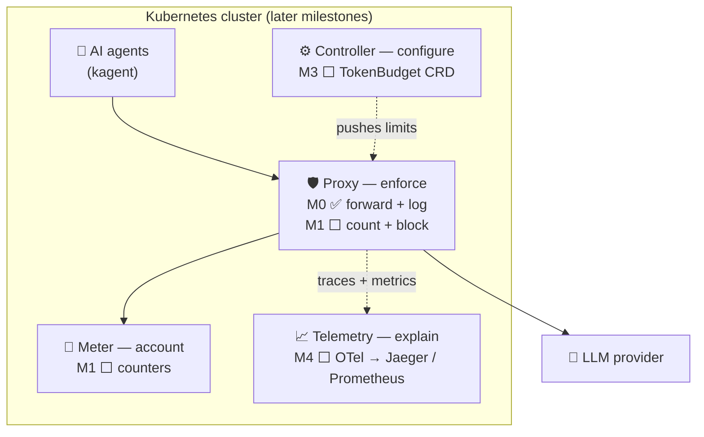
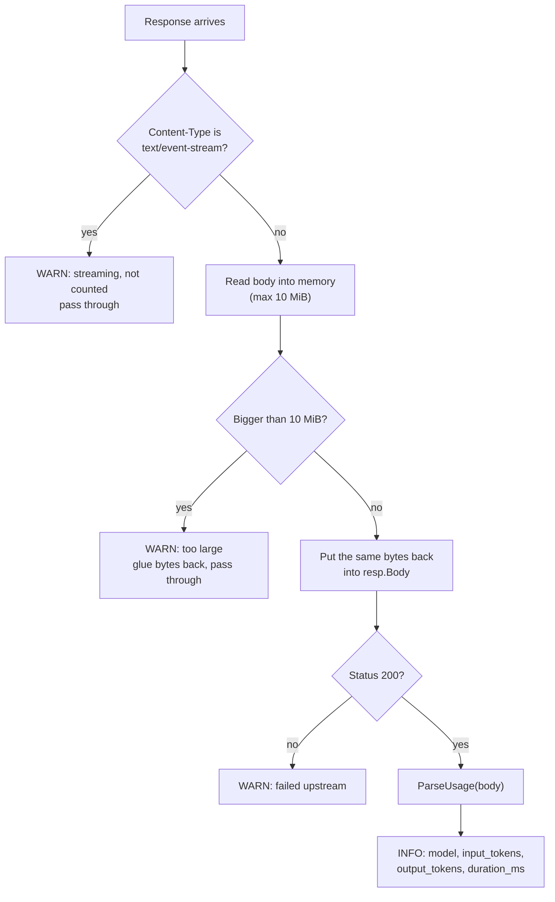
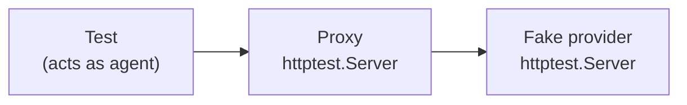

# Architecture

## The big picture

agent-budget will grow into four parts. Only the **proxy** exists today (M0).



| Part | Job | Analogy |
|---|---|---|
| **Proxy** | Stands between agents and the LLM; allows or blocks each request | Canteen counter |
| **Meter** | Adds up tokens after each answer | The register book |
| **Controller** | Reads budgets written as Kubernetes YAML and tells the proxy | The manager who sets each student's monthly limit |
| **Telemetry** | Charts and traces that *explain* spending | The monthly report on the notice board |

One rule from [D-001](DECISIONS.md): **telemetry explains spend; it never enforces it.** Budgets are enforced only from counters on the request path, because traces can be sampled and arrive late.

---

## M0: one request, layer by layer

### 1. The agent sends a request (network)

The agent sends an HTTP `POST` to `http://localhost:8080/v1/chat/completions`.
The operating system delivers it over a **TCP connection** to the process listening on port 8080 — our proxy.

### 2. Go gives it a worker (process)

`cmd/proxy/main.go` started an `http.Server`. For every incoming connection, Go's `net/http` starts a **goroutine** — a very cheap worker (a few KB of memory), so thousands of agents can be served at once.

The server's router (`http.ServeMux`) looks at the path:

- `GET /healthz` → answer `ok` (used by Kubernetes to check the proxy is alive)
- everything else → `proxy.ServeHTTP`

### 3. Stamp the start time

`ServeHTTP` (`internal/proxy/proxy.go`) puts `time.Now()` into the request's **context** — a small bag of values that travels with the request — so we can measure how long the LLM took.

### 4. Rewrite and forward

Go's standard library `httputil.ReverseProxy` does the forwarding. Our `Rewrite` function:

1. `SetURL(upstream)` — changes scheme + host to the provider (e.g. `http://localhost:9090`), keeps the path `/v1/chat/completions`.
2. Deletes `Accept-Encoding` — so Go's HTTP client asks for gzip *itself* and unzips it for us. Otherwise the body could arrive compressed and we couldn't read the tokens.

Headers (including `Authorization`) and body go through unchanged.

### 5. The provider answers

```json
{
  "model": "demo-model",
  "choices": [{ "message": { "content": "…the answer…" } }],
  "usage": { "prompt_tokens": 11, "completion_tokens": 11, "total_tokens": 22 }
}
```

Field names come from the `CompletionUsage` schema in the
[official OpenAI OpenAPI spec](https://github.com/openai/openai-openapi).

### 6. Read the usage (memory)

`ModifyResponse` → `recordUsage` runs **before** the answer is sent to the agent:



Why "put the same bytes back"? An HTTP body is a **stream** — like water through a pipe, once you read it, it's gone. We read it all into a byte slice (`[]byte`) in RAM, look inside, then hand the agent a fresh reader over the same bytes.

`ParseUsage` (`internal/proxy/usage.go`) decodes **only** `model` and `usage`. The Go struct simply has no field for `choices`, so the answer text is never even stored in a variable we use — and never logged.

### 7. Back to the agent

The proxy writes the identical status, headers and body back on the agent's TCP connection. The agent cannot tell the proxy was there.

### 8. Database?

None in M0. Nothing is saved — only one log line is printed. Counters arrive in M1 (in memory) and a database in M5.

---

## Failure cases

| What goes wrong | What the agent sees | What the proxy logs |
|---|---|---|
| Provider is down | `502` with a JSON error | `ERROR upstream unreachable` |
| Provider returns 429 / 500 | the same status and body | `WARN failed upstream` |
| Agent disconnects mid-request | — | nothing (not an error) |
| Streaming answer | the stream, unchanged | `WARN tokens not counted` |

## Shutdown

`signal.NotifyContext` turns **Ctrl+C** (`SIGINT`) or a Kubernetes pod stop (`SIGTERM`) into a cancelled context.
`srv.Shutdown` then stops accepting new connections and waits up to 15 s for running requests to finish — so no agent gets cut off mid-answer.

## Testing strategy

`internal/proxy/proxy_test.go` starts **two in-process servers** with `httptest`:



| Test | Checks |
|---|---|
| `TestProxyForwardsAndLogsUsage` | body unchanged, path + auth forwarded, tokens logged, **no secrets in logs** |
| `TestProxyHandlesGzipFromProvider` | tokens still counted when the provider gzips |
| `TestProxyUpstreamError` | a 429 from the provider passes through |
| `TestProxyStreamingIsPassedThrough` | SSE stream unchanged, warning logged |
| `TestProxyUpstreamDown` | 502 returned, no secrets logged |
| `TestParseUsage` (table) | normal, zero tokens, missing usage, broken JSON, empty body |

All tests run with Go's **race detector** (`go test -race`).
