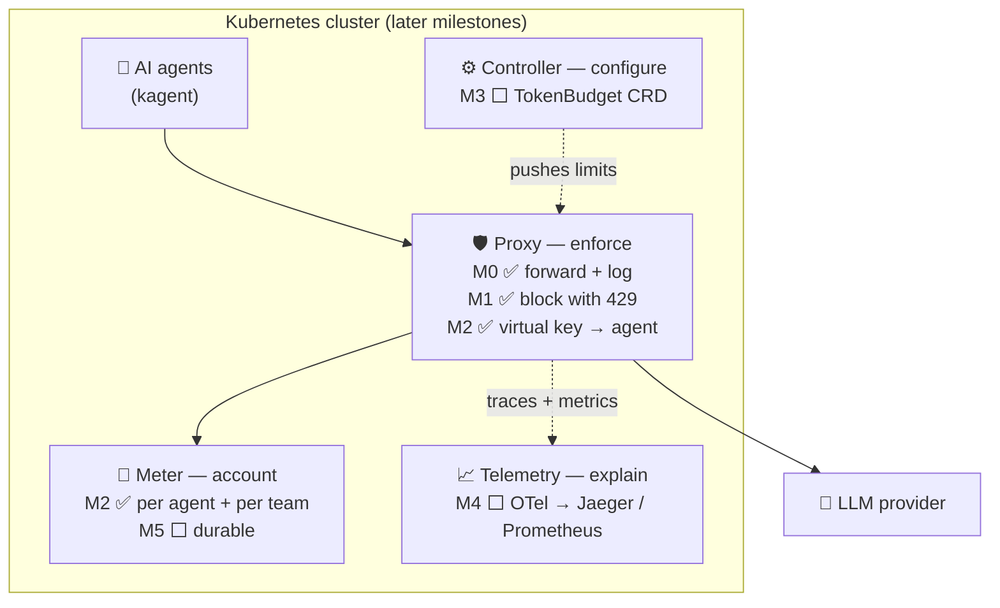
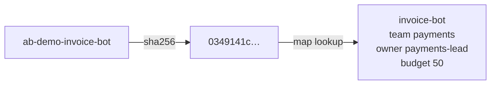
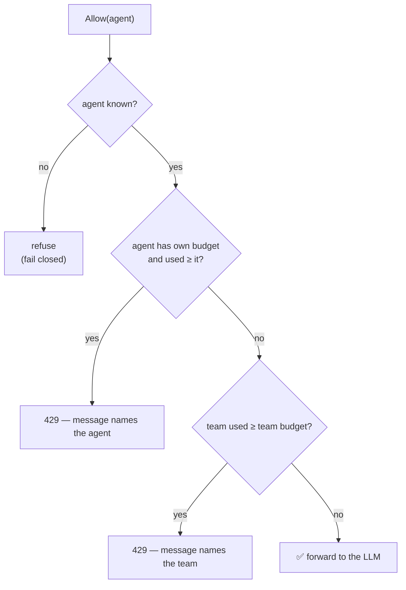
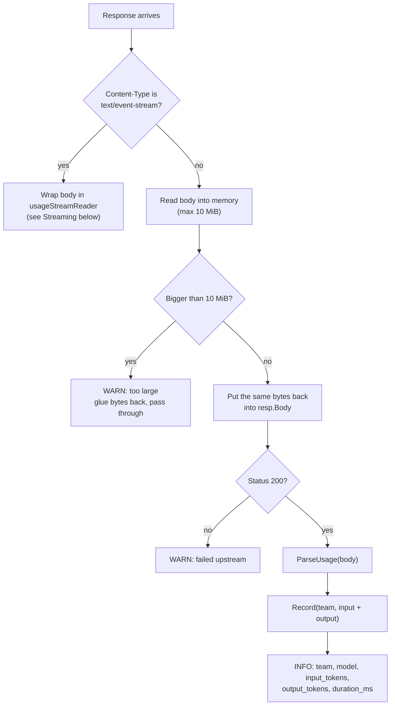
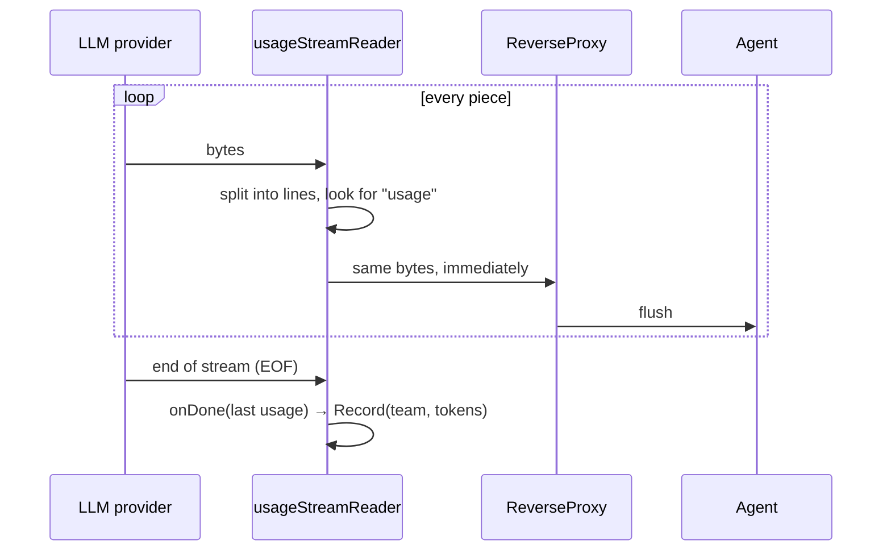
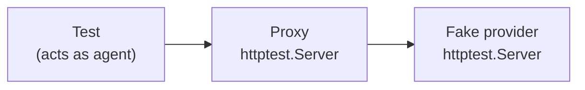

# Architecture

## The big picture

agent-budget will grow into four parts. Today the **proxy**, an in-memory **meter** and an **agent registry** exist (M0 – M2).



| Part | Job | Analogy |
|---|---|---|
| **Proxy** | Stands between agents and the LLM; allows or blocks each request | Canteen counter |
| **Meter** | Adds up tokens after each answer | The register book |
| **Controller** | Reads budgets written as Kubernetes YAML and tells the proxy | The manager who sets each student's monthly limit |
| **Telemetry** | Charts and traces that *explain* spending | The monthly report on the notice board |

One rule from [D-001](DECISIONS.md): **telemetry explains spend; it never enforces it.** Budgets are enforced only from counters on the request path, because traces can be sampled and arrive late.

---

## One request, layer by layer

### 1. The agent sends a request (network)

The agent sends an HTTP `POST` to `http://localhost:8080/v1/chat/completions`.
The operating system delivers it over a **TCP connection** to the process listening on port 8080 — our proxy.

### 2. Go gives it a worker (process)

`cmd/proxy/main.go` started an `http.Server`. For every incoming connection, Go's `net/http` starts a **goroutine** — a very cheap worker (a few KB of memory), so thousands of agents can be served at once.

The server's router (`http.ServeMux`) looks at the path:

- `GET /healthz` → answer `ok` (used by Kubernetes to check the proxy is alive)
- `GET /budgets` → live usage per team and per agent as JSON
- everything else → `proxy.ServeHTTP`

### 3. Who is calling? (M2)

The agent sends its **virtual key**: `Authorization: Bearer ab-demo-invoice-bot`.

`ServeHTTP` (`internal/proxy/proxy.go`) takes the token out of the header and asks the registry (`internal/agents`):

```go
agent, ok := p.agents.Lookup(bearerToken(r.Header.Get("Authorization")))
if !ok {
    writeError(w, 401, "invalid_api_key", "missing or unknown virtual key")
    return
}
```

`Lookup` does **not** compare keys. It computes `sha256(key)` and looks the hash up in a map built at start from the agents file:



The agents file holds only hashes, so reading it does not reveal any key. And because the agent is found **from the key**, an agent cannot claim to be someone else or charge another team — the problem the M1 `X-Budget-Team` header had.

### 3b. May they spend more?

```go
if err := p.budget.Allow(agent.Name); err != nil {
    p.reject(w, r, info, err) // 429 — the LLM is never called
    return
}
```

The meter checks **two** budgets — like pocket money and the family's monthly budget: if either is empty, no more spending.



Blocking here, **before** forwarding, is the whole point: a blocked request costs zero tokens.

The proxy then puts a small `requestInfo{agent, team, start, stream}` into the request's **context** — a bag of values that travels with the request — so the response side knows whom to charge and how long the LLM took.

### 3c. Prepare the body

`prepareBody` reads the whole request body (max 32 MiB, else `413`) and calls `prepareRequest` (`internal/proxy/stream.go`):

- If the body is a JSON object, it is **re-encoded**, so the provider receives exactly what we inspected. (Example attack it stops: `{"stream":false,"stream":true}` — if we read the last key but the provider read the first, a stream could slip through uncounted. This class of bug is called a *parser differential*.)
- If `"stream": true`, it sets `stream_options.include_usage = true`. Without this, the provider sends **no** usage in a stream and we could not count it.

### 4. Rewrite and forward

Go's standard library `httputil.ReverseProxy` does the forwarding. Our `Rewrite` function:

1. `SetURL(upstream)` — changes scheme + host to the provider (e.g. `http://localhost:9090`), keeps the path `/v1/chat/completions`.
2. Deletes `Accept-Encoding` — so Go's HTTP client asks for gzip *itself* and unzips it for us. Otherwise the body could arrive compressed and we couldn't read the tokens.
3. **Swaps the key**: deletes the agent's `Authorization` (the virtual key) and, if `UPSTREAM_API_KEY` is set, adds `Authorization: Bearer <UPSTREAM_API_KEY>`.

The agent never sees the real provider key, and the provider never sees our virtual keys. If one agent's key leaks, you remove that one agent from the file — the provider key stays safe.

*Analogy:* every hostel student has their own ID card; only the warden holds the master key.

All other headers and the body go through unchanged. (In watch-only mode, without `AGENTS_FILE`, the agent's own `Authorization` is passed through.)

### 5. The provider answers

```json
{
  "model": "demo-model",
  "choices": [{ "message": { "content": "…the answer…" } }],
  "usage": { "prompt_tokens": 11, "completion_tokens": 11, "total_tokens": 22 }
}
```

Field names come from the `CompletionUsage` schema in the
[official OpenAI OpenAPI spec](https://github.com/openai/openai-openapi).

### 6. Read the usage (memory)

`ModifyResponse` → `recordUsage` runs **before** the answer is sent to the agent:



Why "put the same bytes back"? An HTTP body is a **stream** — like water through a pipe, once you read it, it's gone. We read it all into a byte slice (`[]byte`) in RAM, look inside, then hand the agent a fresh reader over the same bytes.

`ParseUsage` (`internal/proxy/usage.go`) decodes **only** `model` and `usage`. The Go struct simply has no field for `choices`, so the answer text is never even stored in a variable we use — and never logged.

### 6b. Streaming answers (Server-Sent Events)

With `"stream": true`, the answer arrives in pieces over a few seconds:

```text
data: {"choices":[{"delta":{"content":"Hello "}}],"usage":null}

data: {"choices":[{"delta":{"content":"world"}}],"usage":null}

data: {"choices":[],"usage":{"prompt_tokens":11,"completion_tokens":11,"total_tokens":22}}

data: [DONE]
```

Per the [OpenAI spec](https://github.com/openai/openai-openapi) (`stream_options.include_usage`), every chunk has `"usage": null` **except one extra chunk just before `[DONE]`**, which holds the usage for the whole request.

We cannot read the whole stream first — the agent would wait seconds for the first word. Instead `recordUsage` swaps the body for a **`usageStreamReader`** that *peeks while passing through*:



Details that matter:

- **Lines can be cut in half.** One `Read` may end in the middle of a line. The unfinished part waits in `pending` until its `\n` arrives. A test reads the stream **one byte at a time** to prove this works.
- **Memory is bounded.** A line longer than 1 MiB is passed through but not inspected.
- **Counted exactly once.** `onDone` runs on end-of-stream, on a read error or on `Close` — whichever comes first — guarded by `sync.Once`.
- **Broken streams.** If the agent hangs up or the connection breaks before the usage chunk, nothing is counted and the proxy logs `WARN stream ended without usage`. The spec warns about this case too.

### 7. Back to the agent

The proxy writes the identical status, headers and body back on the agent's TCP connection. The agent cannot tell the proxy was there.

### 8. Memory, not a database

The meter keeps Go maps in RAM: limits and used tokens per team and per agent. Nothing is written to disk, so **restarting the proxy resets every counter**. A database (Redis or Postgres) arrives in M5.

---

## The meter and the mutex

Go's `net/http` runs every request in its own goroutine. With 20 agents calling at once, 20 goroutines may run `teamUsed[team] += tokens` **at the same moment**.

`+=` is really three steps: *read* the old value, *add*, *write* it back. If two goroutines interleave:

| Time | Goroutine A | Goroutine B | `used` in memory |
|---|---|---|---|
| 1 | read 100 | | 100 |
| 2 | | read 100 | 100 |
| 3 | write 100 + 46 = 146 | | 146 |
| 4 | | write 100 + 46 = 146 | **146** ❌ (should be 192) |

B's tokens are **lost** — a *lost update*. With Go maps it is even worse: the runtime crashes with `fatal error: concurrent map read and map write`.

The fix is a **mutex** (`sync.Mutex`) — a lock that only one goroutine can hold at a time:

```go
func (m *Meter) Record(agent string, tokens int64) {
    m.mu.Lock()
    defer m.mu.Unlock()
    team := m.agentTeam[agent]
    m.agentUsed[agent] += tokens
    m.teamUsed[team] += tokens
}
```

Both counters change under **one** lock, so nobody can ever see the agent's tokens added but the team's not yet.

Every method that touches the maps (`Allow`, `Record`, `Snapshot`) takes the same lock.

**Proof:** `TestConcurrentRecord` runs 100 goroutines × 1000 updates. With the lock removed, `go test -race` reports 8 data races and the runtime crashes. With the lock, the total is exact every time.

## Why the limit is soft

The gate checks **before** the request; tokens are added **after** the answer. In between, the meter does not know how many tokens the request will use.

```text
limit 50 │ request 1: used 0  → allowed → +22 → used 22
         │ request 2: used 22 → allowed → +22 → used 44
         │ request 3: used 44 → allowed → +22 → used 66   ← over by 16
         │ request 4: used 66 → 429
```

Also, if 10 requests from one agent arrive at the same time, all 10 may pass the gate before any of them records tokens. So the overshoot is at most *(requests in flight) × (tokens per request)*.

This is the classic **check-then-act** problem. It is accepted for now (D-005). A fix — *reserve* tokens before the call using the request's `max_tokens`, then settle the real amount after — is [IDEA-2](../research/IDEAS.md).

---

## Failure cases

| What goes wrong | What the agent sees | What the proxy logs |
|---|---|---|
| Provider is down | `502` with a JSON error | `ERROR upstream unreachable` |
| Provider returns 429 / 500 | the same status and body | `WARN failed upstream` |
| Agent disconnects mid-request | — | nothing (not an error) |
| Streaming answer | the stream, live and unchanged | `INFO llm request stream=true …` |
| Stream breaks before the usage chunk | whatever arrived | `WARN stream ended without usage` |
| Request body > 32 MiB | `413` | — |
| `stream_options` is not an object | `400` | — |
| Missing or unknown virtual key | `401` `invalid_api_key` | `WARN request rejected` (key not logged) |
| Agent or team over budget | `429` `budget_exceeded` | `WARN request blocked` |
| Agents file is broken | proxy does not start | every problem listed at once |

## Shutdown

`signal.NotifyContext` turns **Ctrl+C** (`SIGINT`) or a Kubernetes pod stop (`SIGTERM`) into a cancelled context.
`srv.Shutdown` then stops accepting new connections and waits up to 15 s for running requests to finish — so no agent gets cut off mid-answer.

## Testing strategy

`internal/proxy/proxy_test.go` starts **two in-process servers** with `httptest`:



| Test | Checks |
|---|---|
| `TestProxyForwardsAndLogsUsage` | body unchanged, path + auth forwarded, tokens logged, **no secrets in logs** |
| `TestProxyHandlesGzipFromProvider` | tokens still counted when the provider gzips |
| `TestProxyUpstreamError` | a 429 from the provider passes through |
| `TestProxyStreamingIsPassedThrough` | stream without usage passes through, warning logged |
| `TestProxyStreamingIsLiveAndCounted` | provider got `include_usage`; first chunk reaches the agent **before** the provider sends the rest; tokens charged |
| `TestProxyStreamingCannotBypassBudget` | 200, 200, then 429 with streams only |
| `TestProxyRejectsBadRequests` | 400 and 413; provider never called |
| `TestPrepareRequest` (table) | include_usage added, other options kept, duplicate keys, non-JSON untouched |
| `TestUsageStreamReader` (table) | one-byte reads, CRLF, no usage, 1 MiB+ line, no trailing newline; `onDone` exactly once |
| `TestProxyUpstreamDown` | 502 returned, no secrets logged |
| `TestParseUsage` (table) | normal, zero tokens, missing usage, broken JSON, empty body |
| `TestVirtualKeyRequired` (table) | no key, wrong key, provider key, the hash itself, `Basic` auth → all 401, provider never called, nothing leaked to logs |
| `TestVirtualKeySwappedForUpstreamKey` (table) | provider sees `UPSTREAM_API_KEY` (or nothing), never the virtual key |
| `TestAgentBudgetBlocks` | agent's own budget: 200, 200, then 429; agent and team both charged |
| `TestTeamBudgetSharedByAgents` | two agents use up their team; a third agent in another team still works |
| `TestBudgetNotChargedOnUpstreamError` | a failed call costs nothing |
| `TestConcurrentRequestsCountedExactly` | 20 workers × 10 requests through the real proxy, exact agent and team totals |
| `TestAllow`, `TestSnapshot` (tables) | meter rules: own limit, team limit, unknown agent |
| `TestConcurrentRecord` | 100 goroutines × 1000 updates, no lost updates |
| `TestParse` (table), `TestLookup` | agents file validation (typos, missing owner, shared keys…) and key → agent |
| `TestExampleFileIsValid` | `examples/agents.json` loads and the demo keys in the docs really work |

All tests run with Go's **race detector** (`go test -race`).

**Testing the tests.** For the two most important tests we checked that they fail when the code is broken on purpose (*mutation testing*): removing the meter's mutex makes `TestConcurrentRecord` report data races, and buffering the whole stream makes `TestProxyStreamingIsLiveAndCounted` fail with "the proxy is buffering the stream".
